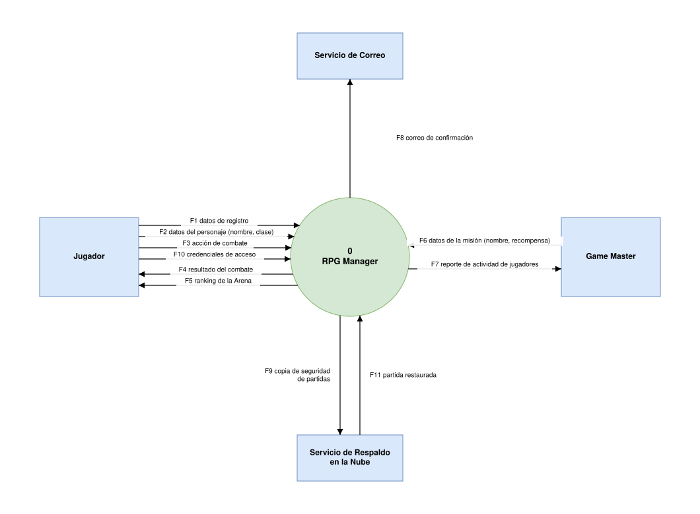
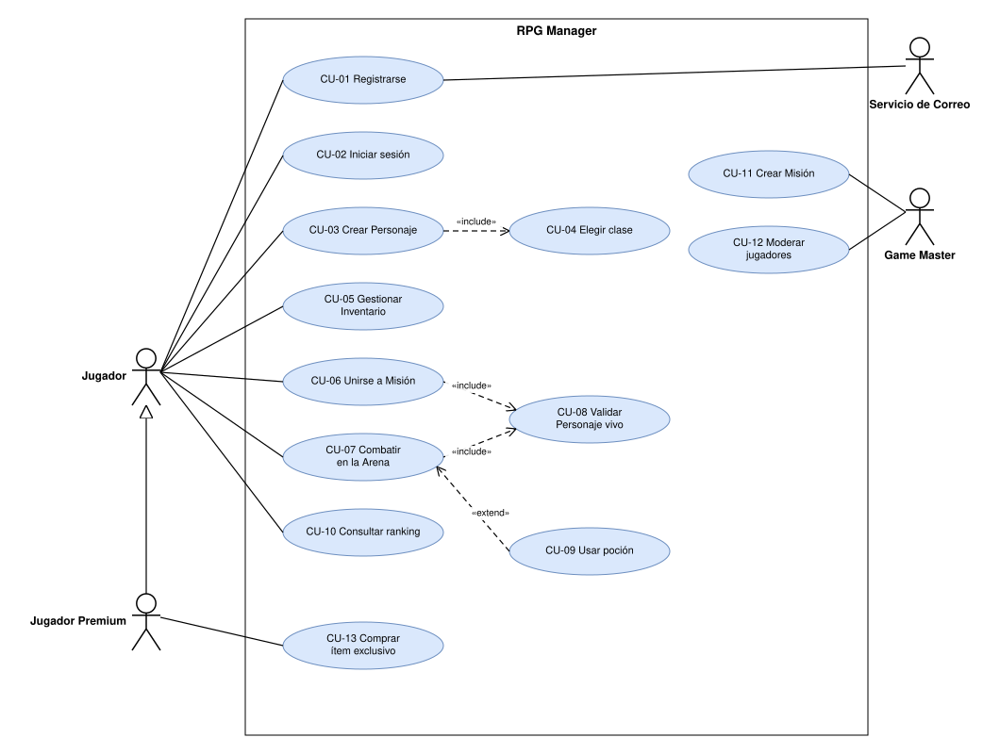
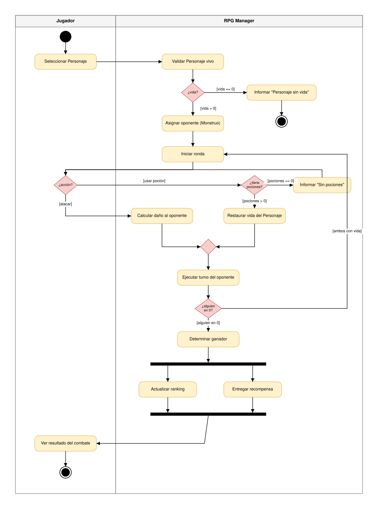
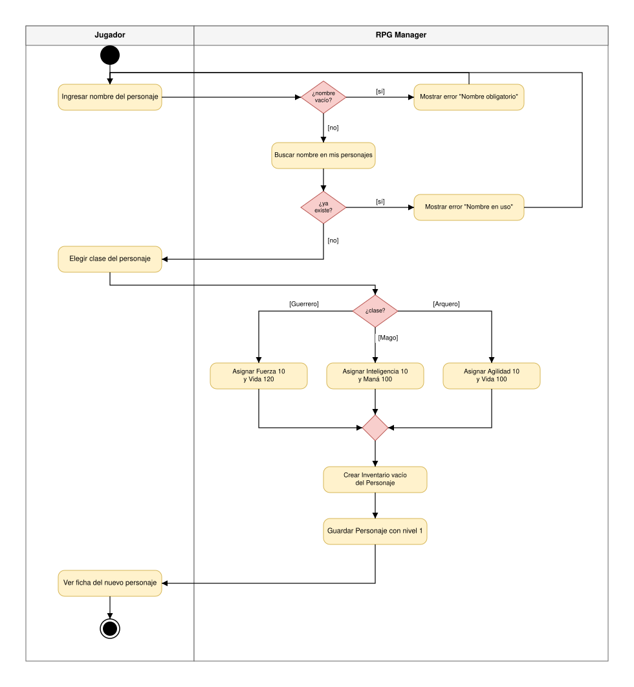

# Taller · Diagramas con draw.io · RPG Manager

**Herramienta:** draw.io (app.diagrams.net), exportado a SVG con copia del diagrama incluida

Los tres diagramas describen el mismo sistema, el RPG Manager, a tres distancias:
el contexto muestra con quién intercambia datos, los casos de uso muestran qué
puede lograr cada actor y el de actividades muestra cómo ocurre paso a paso un
caso de uso concreto.

| Archivo | Contenido |
|---|---|
| `01_contexto_rpg.drawio` / `.svg` | DFD nivel 0 con los flujos F1 a F11 |
| `02_casos_uso_rpg.drawio` / `.svg` | 13 casos de uso, 4 actores, include, extend y generalización |
| `03_actividades_combate.drawio` | Dos páginas: CU-07 Combatir en la Arena y CU-03 Crear Personaje |
| `03_actividades_cu07.svg` | Página 1 exportada |
| `03_actividades_cu03.svg` | Página 2 exportada |

Las respuestas de los ejercicios 1A, 2A, 3A y 3B, los bugs a corregir y las
preguntas de reflexión están diligenciadas en el documento físico del taller.

---

## Bloque 1 · Diagrama de contexto

Proceso 0, cuatro entidades externas y once flujos de datos nombrados con sustantivos.
Incluye F10 y F11 del ejercicio 1A.

---

## Bloque 2 · Diagrama de casos de uso

Actores fuera del límite del sistema, asociaciones sin punta, «include» del caso
base al incluido, «extend» del opcional al base, y generalización de Jugador
Premium hacia Jugador con el caso CU-13 del ejercicio 2A.

---

## Bloque 3 · Diagrama de actividades

### CU-07 Combatir en la Arena

Carriles Jugador y RPG Manager, decisiones con guardas en todas sus salidas,
ciclo de rondas, decisión de pociones del ejercicio 3A y fork / join al final.

### CU-03 Crear Personaje (ejercicio 3B)

Validación de nombre vacío y duplicado, decisión de clase con tres salidas y
creación del inventario vacío del personaje.

---

## Bloque 4 · Exportación y GitHub

Cada diagrama se exportó a SVG con la opción "Include a copy of my diagram", así
que cualquiera de los `.svg` se puede volver a abrir en draw.io y editar. Los
`.drawio` se conservan como fuente.

---

## Autoevaluación

| Tema | Nivel |
|---|---|
| Manejo básico de draw.io | ¡Lo tengo! |
| Diagrama de contexto y flujos de datos | ¡Lo tengo! |
| Actores y casos de uso | ¡Lo tengo! |
| «include», «extend» y generalización | ¡Lo tengo! |
| Decisiones, guardas y carriles | ¡Lo tengo! |
| Fork / Join | Más o menos |
| Exportar y versionar en GitHub | ¡Lo tengo! |
